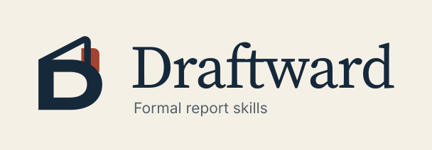

<h1></h1>

**Agent Skills for formal reports, from brief to final PDF.**

Draftward helps you draft academic, technical, and professional reports. It connects requirements to sections and claims to evidence, so you can see what the draft covers and where it needs work. The skills follow the [Agent Skills format](https://agentskills.io/specification).

## Choose a skill

| Skill | Use it when you want to |
| --- | --- |
| [`$report-drafting`](skills/report-drafting/SKILL.md) | Turn a brief and source material into an outline or draft and identify which reporting rules apply. |
| [`$report-review`](skills/report-review/SKILL.md) | Review a whole report, reconcile feedback with the rubric, or plan the next revision. |
| [`$report-clarity`](skills/report-clarity/SKILL.md) | Improve terminology, flow, and reader context while preserving the report's meaning. |
| [`$report-evidence`](skills/report-evidence/SKILL.md) | Trace claims to their evidence and verify results, citations, and limitations. |
| [`$report-release`](skills/report-release/SKILL.md) | Rebuild and check a final PDF, including layout, links, and passage locations. |

For a new report, start with drafting. For a substantial revision, start with review. Use clarity and evidence checks where needed, then run release on the final export.

## Reporting standards

The [standards guide](skills/report-drafting/references/report-standards.md) points to official sources for academic and industry reporting, citation styles, and accessibility. Draftward checks which requirements apply to the specific report and records any that need confirmation.

The [companion skills guide](skills/report-drafting/references/companion-tools.md) shows how to use separately installed citation and document skills alongside Draftward.

## Install in Codex

1. Clone this repository or download and extract its ZIP from GitHub.
2. In your report project, create `.agents/skills/` if needed. Copy the folders **inside** [`skills/`](skills/) into it, so each entry point is at `.agents/skills/<skill-name>/SKILL.md`. Keep the folders together so their shared guidance remains available.
3. Open the report project in Codex and mention the skill you want to use. See [Codex skill discovery and invocation](https://learn.chatgpt.com/docs/build-skills).

## Example prompts

- `Use $report-drafting to outline a technical evaluation from this brief and test summary. Flag missing evidence before drafting the conclusions.`
- `Use $report-review to review this draft against the supplied rubric and propose a revision plan.`
- `Use $report-clarity to improve the discussion while preserving the technical meaning and authorial voice.`
- `Use $report-evidence to check the results section against the supplied evaluation summaries.`
- `Use $report-release to rebuild the report and check the final PDF's figures, links, and page references.`

Provide the current draft and the materials relevant to the task, such as the rubric, evidence summaries, or build instructions. The skills are Markdown instructions. PDF rebuilding uses the report project's existing toolchain.

## Repository layout

Each skill starts at `skills/<skill-name>/SKILL.md`, with supporting guidance in `references/` and Codex interface metadata in `agents/openai.yaml`. Edit these source folders directly. Git ignores generated `.skill` archives.

The [brand guide](assets/README.md) includes the identity sheet, logo exports, and editable ArtCraft source.

See [Contributing](CONTRIBUTING.md) for changes to skills and the standards guide.
