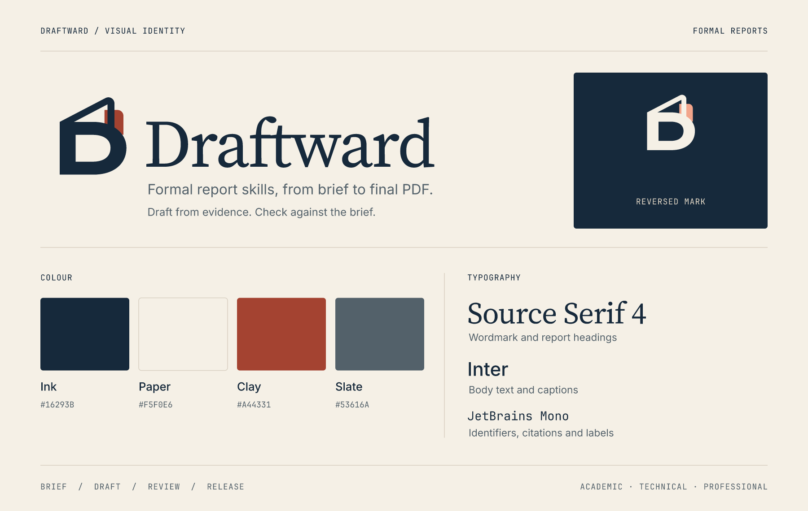

# Draftward brand guide

Draftward is a set of agent skills for drafting and verifying formal reports. The folded folio forms a capital D. The clay tab draws on the way a reader marks a source or a passage to revisit.

## Logo files

| File | Use |
| --- | --- |
| [Horizontal lockup](draftward-lockup.svg) | Repository header and introductory material. The ivory field and outlined type make it portable across themes and hosts. |
| [Repository avatar](draftward-avatar.png) | Square icons, avatars, and places that require a raster file. |
| [Primary mark](draftward-mark.svg) | Transparent logo for light backgrounds. |
| [Reversed mark](draftward-mark-reversed.svg) | Transparent logo for dark backgrounds. |
| [GitHub social card](draftward-social.png) | 1280 × 640 Open Graph artwork for the repository's social preview setting. |
| [Editable identity](draftward-identity.vectorcraft) | ArtCraft VectorCraft source with separate artboards for the identity sheet and every logo export. |

Allow clear space of at least one quarter of the visible mark's height on each side. Use the symbol alone in small or square placements and keep the lockup's proportions when scaling.

## Colour and type

Use Ink (`#16293B`) for text on Paper (`#F5F0E6`). Use Slate (`#53616A`) for supporting copy and Clay (`#A44331`) as an accent. The reversed mark uses Paper with an Apricot tab (`#F2A58B`).

Use Source Serif 4 for the wordmark and display headings, Inter for body text, and JetBrains Mono for identifiers and labels. The wordmark reads **Draftward**, with an initial capital.

Describe the work in direct, specific language. Name the report, the evidence it uses, and the checks it still needs. The short descriptor is **Formal report skills**.
